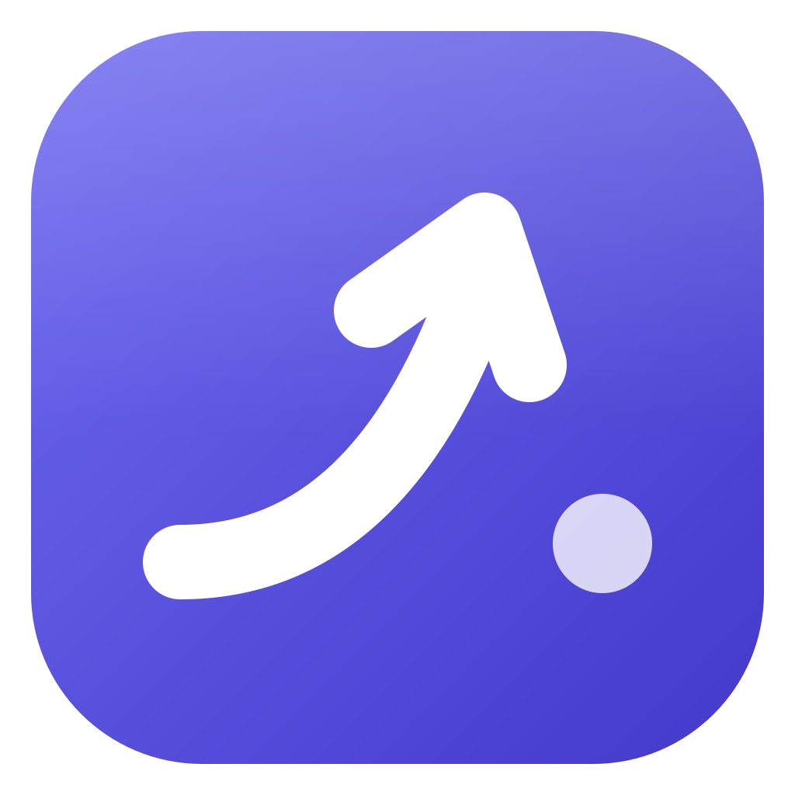
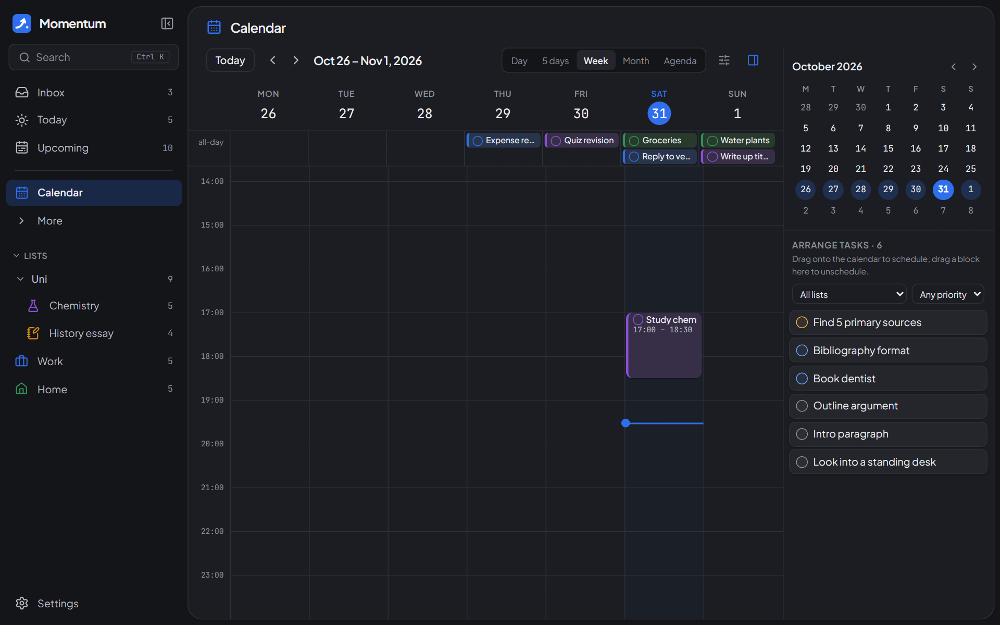
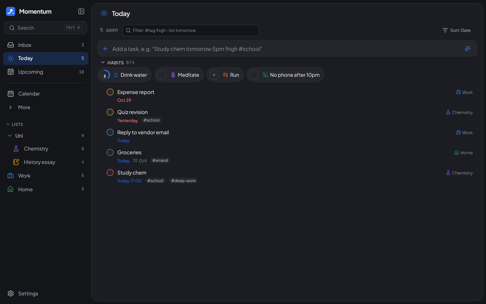
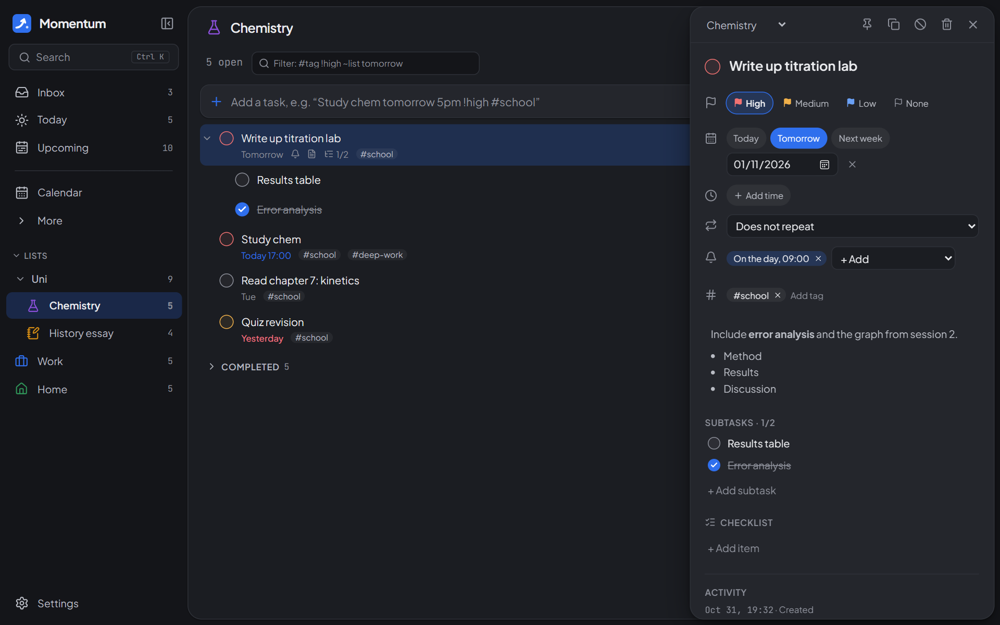
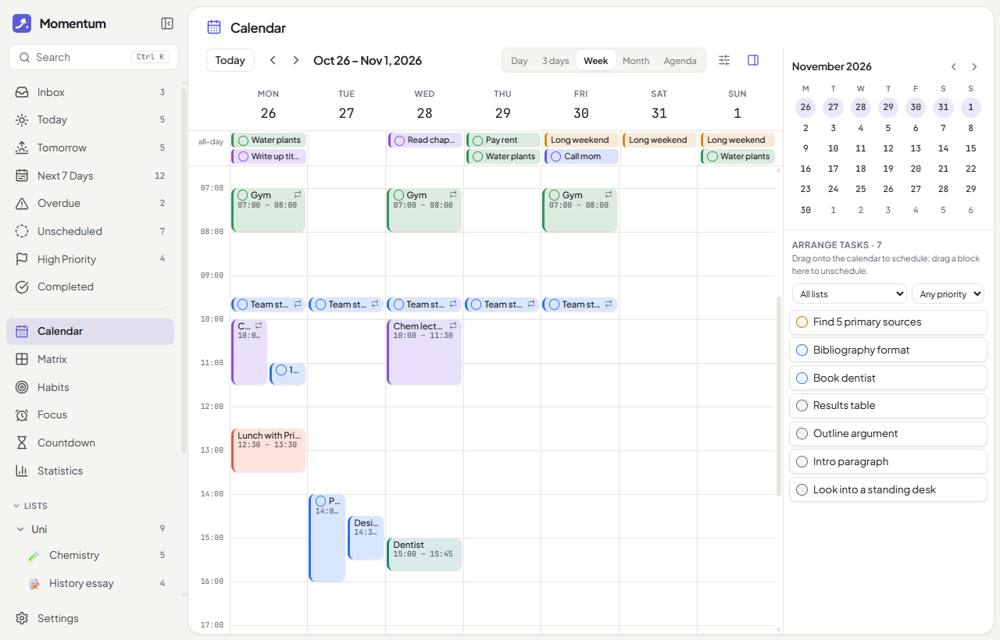
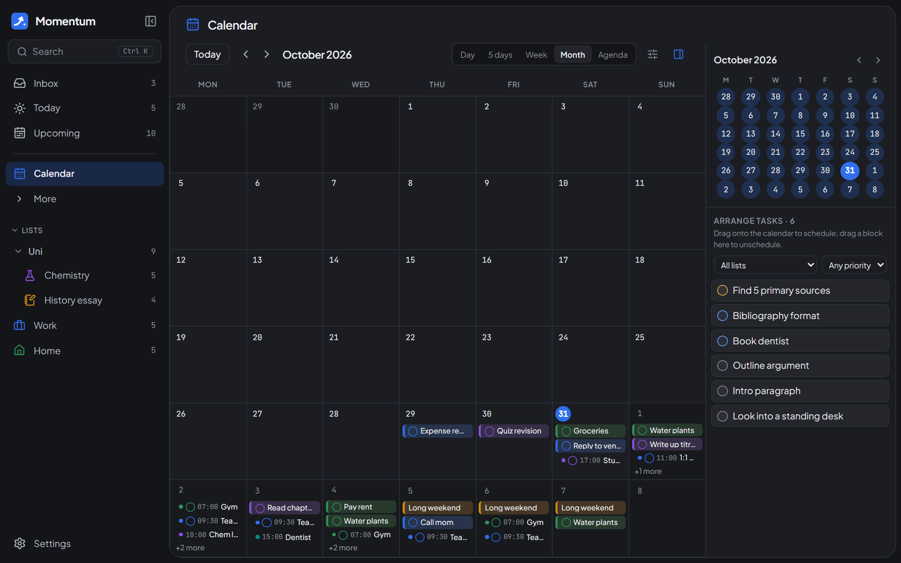
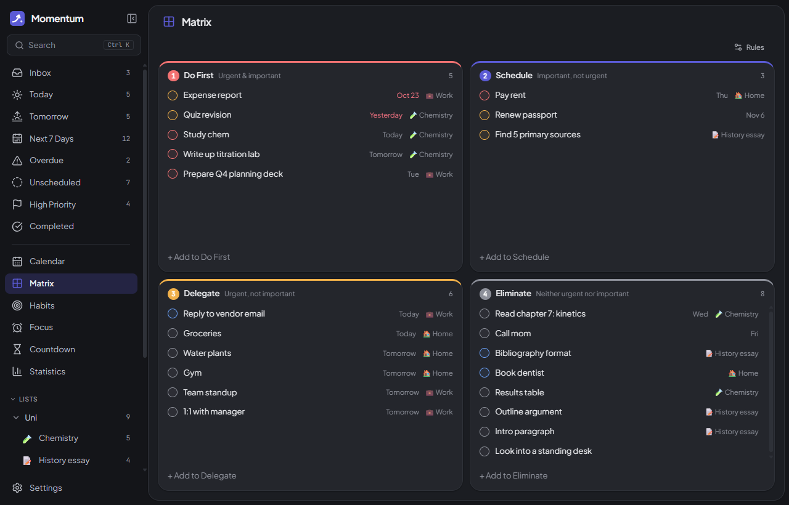
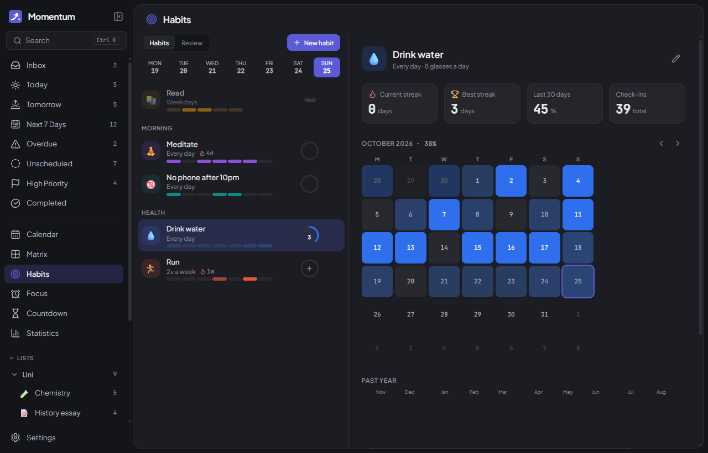
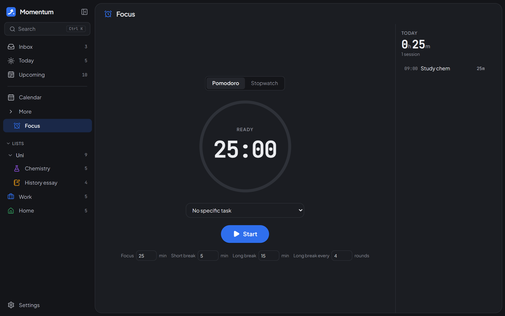
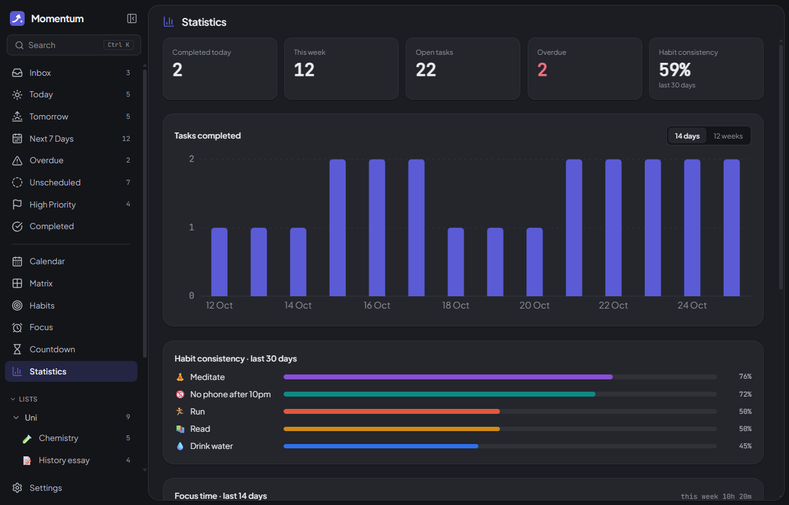

<p align="center">
  
</p>

<h1 align="center">Momentum</h1>

<p align="center">
  An all-in-one, offline desktop planner: tasks, a drag-and-drop calendar, habits, an Eisenhower Matrix, focus timer and countdowns.<br />
  Local-first. No account, no cloud, no telemetry. Your data never leaves your computer.
</p>

<p align="center">
  
</p>

## Features

**Tasks**
- Quick-add bar with natural language: `Study chem tomorrow 5pm !high #school ~Uni every mon` sets the date, time, priority, tag, list and repeat, with each recognised piece shown as a chip. Press <kbd>Esc</kbd> to keep the text literal.
- Smart Lists are live queries, not copies: Inbox, Today (including overdue), Upcoming (grouped by day) and a Logbook of finished tasks.
- Filter any view with the quick-add syntax (`#work !high ~Uni tomorrow`, plus `overdue`, `nodate`, `done`, `wontdo`), and pin a filter to the sidebar to keep it. Click a tag on a task to filter by it.
- Lists with colours and icons, folders, tags, and subtasks up to 5 levels. Drag to reorder, or drag onto a list, Today or Upcoming in the sidebar.
- Subtasks belong to their task: they nest under it in lists, while the Matrix, Calendar and Focus timer show the parent with its progress. Completing a task completes its open subtasks, and the Focus timer lists the subtasks so you can tick them off as you go.
- A quiet sidebar: Calendar up top, the other tools (Matrix, Habits, Focus, Countdown, Statistics) under a collapsible More.
- Each list can be shown as a list, a Kanban board (custom sections) or a timeline. Group by list, date, priority or tag, and sort by date, priority, created, title or manual order.
- Task drawer:
  - Markdown notes, date, time and duration, multiple reminders, repeat rules (presets or custom).
  - Priority, tags, subtasks, checklist, pin, duplicate, won't-do.
  - Activity history.
- Recurring tasks ask whether a change applies to *this occurrence*, *this and following* or *all*.
- Multi-select with <kbd>Ctrl</kbd>/<kbd>Shift</kbd>-click opens a bulk toolbar (complete, date, priority, move, tag, delete). There's undo for everything: a toast button or <kbd>Ctrl Z</kbd>.
- <kbd>Ctrl K</kbd> command palette to search tasks, lists, tags and habits, or run commands.
- Keyboard-first: <kbd>G</kbd> then a letter jumps to a view, <kbd>J</kbd>/<kbd>K</kbd> move between tasks, <kbd>1</kbd>–<kbd>3</kbd> set priority, <kbd>T</kbd> schedules for today, <kbd>C</kbd> completes, <kbd>/</kbd> filters. <kbd>?</kbd> lists them all.
- Calm motion throughout. Settings → Animations follows your system setting, or turn it on or off.

**Calendar**
- Day, 3-Day, Week, Month and Agenda views, with an all-day row, a now-line, a mini month picker and keyboard shortcuts (<kbd>D</kbd> <kbd>X</kbd> <kbd>W</kbd> <kbd>M</kbd> <kbd>A</kbd> <kbd>T</kbd> <kbd>←</kbd> <kbd>→</kbd>).
- Click or drag on empty space to create a task or event inline.
- Drag blocks to move them, including between days. Drag their edges to resize. Everything snaps to 15 minutes.
- *Arrange Tasks* panel: drag unscheduled tasks onto the grid, or drag a block back to unschedule it.
- Overlapping items sit side by side, and Month view shows "+N more".
- Colour items by list, priority or tag. Show or hide completed tasks, habits and focus records.
- One-time, read-only `.ics` import (e.g. a Google Calendar export). Re-importing the same file updates the events instead of duplicating them.

**Eisenhower Matrix**: four quadrants derived from priority and due date, with adjustable rules (default: *important* = Medium/High priority, *urgent* = due within 2 days or overdue). Dragging a task to another quadrant changes its attributes to match.

**Habits**:
- Goal types: complete once, count up (e.g. 8 glasses), or enter an amount (e.g. 5 km).
- Frequency: daily, specific weekdays, or X times a week. Streaks follow the frequency.
- Notes and mood for each check-in, groups, current and best streak, a monthly grid, a yearly heatmap, and weekly/monthly reviews.

**Focus & countdowns**: Pomodoro and stopwatch timers linked to a task, focus statistics, and countdowns that can repeat yearly or monthly.

**System**:
- Native notifications plus a reminder popup with *Done / Snooze / Open*.
- Runs in the tray, so reminders still fire after you close the window.
- Optional launch at login.
- Global <kbd>Ctrl Shift A</kbd> opens quick add from anywhere.
- Automatic updates: Momentum checks GitHub for a new release at launch and installs it with one click. This is its only network request, and you can turn it off in Settings → System.

**Design**: light, dark and system themes, 9 accent presets with Ocean blue as the default (the taskbar and tray icons take the same colour), comfortable or compact density, adjustable font size, and the sidebar on the left or right. Motion is subtle and respects reduced-motion settings. Keyboard navigation works throughout, and <kbd>?</kbd> shows a shortcut sheet.

## Screenshots

| | |
|---|---|
|  |  |
|  |  |
|  |  |
|  |  |

## Install

Download the latest installer from the **[Releases](../../releases)** page. After that, Momentum updates itself.

- **Windows:** `Momentum_x.y.z_x64-setup.exe` (or the `.msi`).
  > **SmartScreen warning:** Momentum isn't code-signed, so Windows may show *"Windows protected your PC"*. Click **More info → Run anyway**. This is normal for open-source apps without a paid certificate.
- **macOS:** the `.dmg` for your Mac (`aarch64` = Apple Silicon, `x64` = Intel). The app is unsigned, so the first time you open it, right-click it and choose **Open**.
- **Linux:** the `.AppImage` (make it executable) or the `.deb`.

Your data lives in `%APPDATA%\com.momentum.planner\` on Windows (`~/Library/Application Support/com.momentum.planner/` on macOS, `~/.config/com.momentum.planner/` on Linux). The database is backed up automatically before every update that changes its structure. You can also export or restore a JSON backup from **Settings → Data**.

## Build from source

Prerequisites:
- [Node.js](https://nodejs.org) 20 or newer.
- [Rust](https://rustup.rs) (stable).
- The [Tauri prerequisites](https://tauri.app/start/prerequisites/) for your OS. On Windows that's the *Visual Studio Build Tools* with **Desktop development with C++**, plus WebView2, which is already included in Windows 10 and 11.

```bash
git clone https://github.com/prpiece/momentum.git
cd momentum
npm install
npm run tauri dev      # run the app with hot reload
npm test               # unit tests (recurrence, DST, matrix rules, streaks, NL parsing, …)
npm run tauri build    # installers → src-tauri/target/release/bundle/
```

`npm run dev` runs the UI alone in a browser, with sample data and no persistence. That's handy for UI work. `npm run screenshots` regenerates the images in `docs/screenshots/` from that build (it uses Microsoft Edge). In `tauri dev`, **Settings → Developer → Load sample data** fills the real database.

## Cutting a release

1. Bump the version in `package.json` and `src-tauri/tauri.conf.json` (and `src-tauri/Cargo.toml`).
2. Commit, then tag and push:
   ```bash
   git tag v0.2.0
   git push origin v0.2.0
   ```
3. The **Release** workflow (`.github/workflows/release.yml`) runs the tests, then builds Windows, macOS (Apple Silicon + Intel) and Linux installers with `tauri-action`, and attaches them to a **draft** GitHub Release.
4. Check the draft on GitHub, edit the notes and publish it. Publishing is what makes installed copies offer the update.

The workflow signs the update bundles with the `TAURI_SIGNING_PRIVATE_KEY` and `TAURI_SIGNING_PRIVATE_KEY_PASSWORD` repository secrets. A fork needs its own key pair (`npx tauri signer generate`): put the public key in `plugins.updater.pubkey` in `tauri.conf.json` and point `endpoints` at the fork's releases.

## Tech

Tauri 2 (Rust) · React + TypeScript + Vite · Tailwind CSS v4 with CSS-variable design tokens · Zustand · SQLite (`tauri-plugin-sql`) with versioned migrations · dnd-kit · date-fns · rrule · chrono-node · ical.js · lucide-react · fonts bundled with @fontsource · Vitest.

Architecture notes and the decision log are in [PLAN.md](PLAN.md). Conventions for contributors (and AI agents) are in [CLAUDE.md](CLAUDE.md).

## Credits

Thanks to [@dalba0](https://github.com/dalba0) for the idea behind Momentum and for testing the app throughout.

## License

[MIT](LICENSE)
